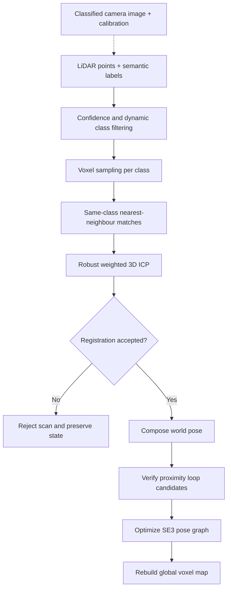

# Class-Aware Point Cloud SLAM

A compact, runnable research baseline for using semantic classes to remove potentially dynamic objects and match stable 3D landmarks.

**Status:** offline Python implementation with synthetic validation. No real-world accuracy, real-time throughput, trained segmentation model, or ROS2 runtime validation is claimed.

## Quick start

```bash
git clone https://github.com/halim-abdul/Class-Aware-Point-Cloud-SLAM.git
cd Class-Aware-Point-Cloud-SLAM
python -m venv .venv
# Linux/macOS: source .venv/bin/activate
# PowerShell: .venv\Scripts\Activate.ps1
pip install -e ".[dev]"
pytest -q
class-slam --output outputs/demo
```

The demo generates 24 synthetic scans, removes moving-class points, estimates sensor poses, verifies nearby loop candidates, optimizes the pose graph, and saves a map, poses, reference poses, and JSON metrics. Distances are in metres.

## Workflow



For example: points labelled as people or vehicles are removed; building points match building points; confidence and residual size control how strongly a match affects the pose estimate.

## Implemented features

| Component | Implementation |
|---|---|
| Input | Validated NumPy point clouds and compressed NPZ input/output |
| Semantics | Integer labels, confidence, configurable dynamic IDs |
| Camera fusion | Calibrated image projection with visibility checks |
| Registration | Class-constrained KD-tree matching, Huber weights, weighted Kabsch |
| Odometry | Scan-to-scan SE(3), convergence/inlier/RMSE acceptance |
| Loops | Pose-proximity proposals with semantic ICP verification |
| Optimization | Anchored SE(3) graph using robust nonlinear least squares |
| Mapping | Rebuild after optimization; highest-confidence voxel representatives |
| Evaluation | Translation ATE and one-step translation RPE |
| Reproducibility | Seeded synthetic demo, tests, GitHub Actions |
| Integration | C++ filtering example and ROS2 integration contract |

## Your own data

```python
import numpy as np
from class_slam import Cloud, SLAM

slam = SLAM(dynamic=(10, 11))
for filename in ["scan_000.npz", "scan_001.npz"]:
    slam.add(Cloud.load(filename))
slam.optimize()
slam.map().save("map.npz")
np.save("poses.npy", np.asarray(slam.poses))
```

Each NPZ contains `points: float[N,3]`, `labels: int[N]`, and `confidence: float[N]`.
Input scans use the sensor frame. Pose matrices map sensor coordinates to the world frame.
The first accepted scan defines the world origin. Labels must share a consistent taxonomy across scans.

## Explore

- [Data format](docs/data.md)
- [Mathematics and conventions](docs/method.md)
- [Evaluation protocol](docs/evaluation.md)
- [ROS2 and C++ integration](docs/integration.md)
- [Limitations and research roadmap](docs/limitations.md)
- [Notebooks](notebooks/README.md)
- [C++ filter](cpp/README.md)

## Branches

`main`, `data`, `classes`, `slam`, `loops`, `tests`, `examples`, `docs`.

The feature branches retain the corresponding implementation milestones. Main contains the integrated project.

## Practical limits

This is a local registration baseline: it needs adequate static overlap and small inter-frame motion.
Proximity loops depend on the current trajectory estimate and are not global place recognition.
Semantic labels are supplied externally; the demo uses known synthetic labels.
Dense graph optimization and full map rebuilding target small offline experiments.
The map has no temporal decay, free-space reasoning, or long-term object tracking.
Class identity alone does not prove an object is moving or stationary.

MIT licensed. See [LICENSE](LICENSE).
